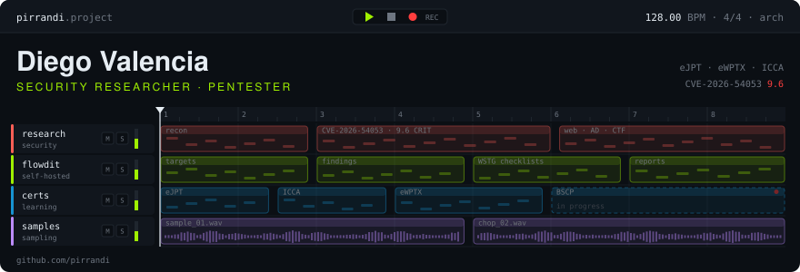
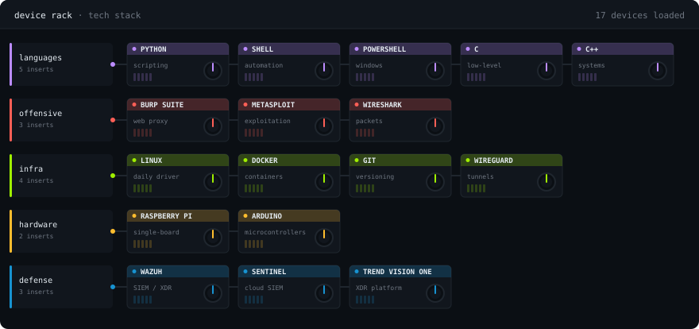

  

<!--

  

<!--
<h3 align="center">
  <samp>&gt; 𝚃𝚎𝚌𝚑 𝚂𝚝𝚊𝚌𝚔</samp>
</h3>

 
-->

  

##

<h3 align="center">
  <samp>&gt; 𝙲𝚎𝚛𝚝𝚜 &amp; 𝙲𝚅𝙴𝚜</samp>
</h3>

 

  
  
  
  
  

<!--
## 🤝 Connect With Me

  

-->
